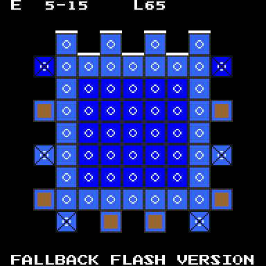
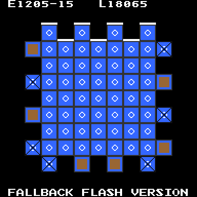
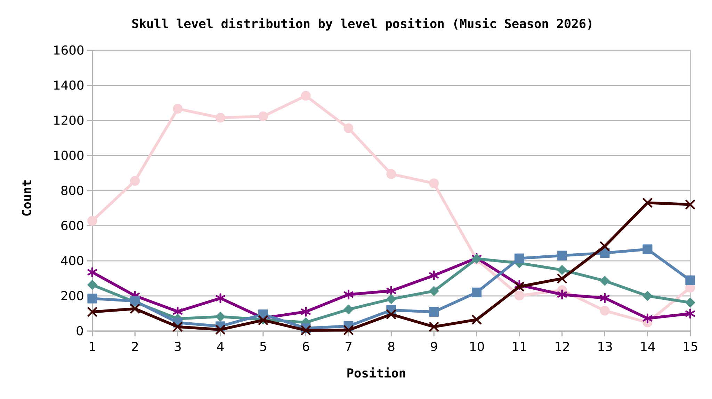
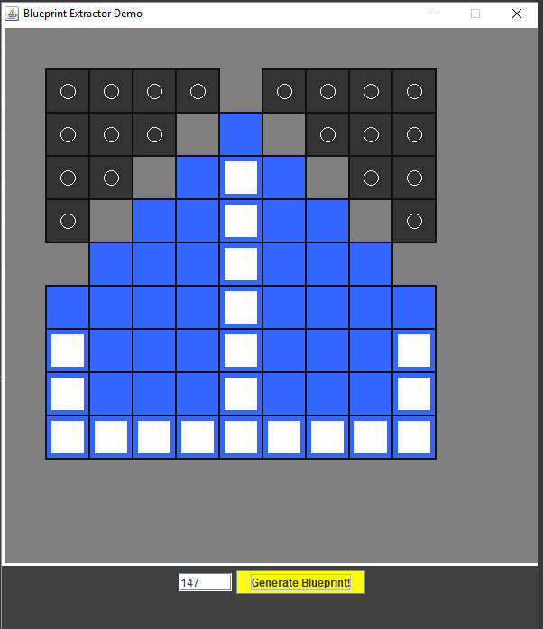
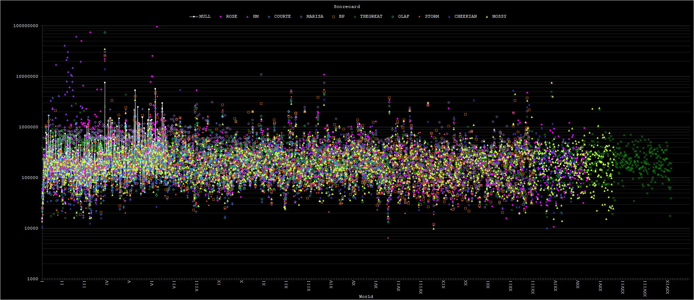

# CCS Extractor
This is a GitHub repository of __historical configs__ and __config extractor__ for Candy Crush games. Currently, the repository is supporting _Candy Crush Saga_ and _Candy Crush Soda Saga_. The extractors are also paired with livestreamed walkthroughs, featuring a 4000+ streak.

I have also developed an extractor (which is semi-closed source) to analyze each of the thousands-strong levels and config sets of Candy Crush. This is _not_ an open-source project.

* __Author:__ --MULLIGANACEOUS-- [(FANDOM)](https://candycrush.fandom.com/wiki/User:--MULLIGANACEOUS--)




# File Structure

The file structure as of now are:

```
archive     : This directory lists select archived config files. They are categorized by epoch. Please do not try to decipher the names.
blueprints  : This directory lists the most current blueprints for each level for the game. This directory has been cleared for now.
charts      : This directory lists all current and historical statistical charts for the games.
    Systematic1: These charts were made during the first systematic era (2020-2023).
*_Extractors: These directories include all extractor versions and the instant extractors and scripts.
*_Scripts   : These directories include all instant scripts for transferring app config files to this directory, and then processing the contents for data analysis and presentation to the wiki and discord. Subdirectories are for certain functionalities regarding specific config files and sections of the wiki.
    *_extract: All instant extractors and config file converters.
    hexagon  : All scripts for determining hexagon levels and converting them into a Lua script for the wiki.
    wikia:   : All scripts for presenting information and charts on Fandom and Discord activity.
KING_Others : Configs for other KING games.
```

# Blueprints

The blueprints are designed in the style of 8-bit graphics while adhering to the limitations as closely as possible. The size of the blueprints are much smaller than the size of the screenshots.

Detailed diagrams of the blueprints will come soon in a future update.

# Walkthroughs
The extractor is also present in selected livestreamed walkthroughs as omake content placed at the end. The omake content can be far longer than the main run. The walkthroughs with omake are:
* [Episode 440, Diamond Digger Saga Claude run I](https://www.youtube.com/live/_eZ-nYVEvlc?si=vPRu3ulD4dOWNTj2)
* [Episode 441, Diamond Digger Saga Claude run II feat. Suno](https://www.youtube.com/live/UyCrJdUgOWY?si=_-C7fM2JYYFtjcgk)
* [Episode 443, Assorted HTML5 era blueprints](https://www.youtube.com/live/5tjpNye85NI?si=e7eTDemnNd_a9dyS)
* [Episode 444, Soda blueprints up to L2725](https://www.youtube.com/live/A3ME_yESRWU?si=ht-_RehlhbHgWLZG)
* [Episode 445, Flash era blueprints](https://www.youtube.com/live/vkXCWJp0JFs?si=cpCtAkq4dlmEoCBv)

# Timeline
Unfortunately I have been away for years, and only recently came back. An extenuating circumstance happening during the covid years had significantly limited my involvement with Candy Crush Saga. 2020 and 2021 have been especially terrible, as I have to deal with an extenuating family situation. I had to pause my development of this now-legacy extractor program until the 2026 Winter Olympics.

## Valentine 2026 Revival



Originally strictly a closed-source solo project, I am gathering collaborators so they can use my extractor software. The software will be rearchitectured to a microservices-based solution. An instant extractor implemented in Python has been established.

## Halloween 2023 Revival Attempt


As discussed on Discord, I noticed several significant concerns regarding the current state of the wiki, but this is also due to the booster-heavy nature of modern gameplay progression, the dearth of comments especially for the high levels and episodes, the focus on events rather than on the main map, and the de-emphasis of scoring and story. As a result, to keep the wiki up-to-date, there has to be radical changes.

I have been mostly inactive during this period although I have played this game in two spates, mostly in the holiday season.

## 2020 Hiatus


Extenuating situation coupled with a transition to a more diverse portfolio of projects means I have to take a hiatus from the _Candy Crush Saga_ wiki community. I also became the first and only Nitro Crusher on Discord.

## 2017 Administrator


Initial work on the config extractor has commenced. Archived versions are compressed and locked.

## 2015 Rollback


Serious contributions started in 2015, beginning with providing images of new levels.

# TODO
Currently, only _Candy Crush Saga_ is in active development. I have worked on the _Candy Crush Soda Saga_ but I have unfortunately decided to put this project on a long hiatus; further changes to the game, including the limitation to the first one hundred levels and extremely unfavorable test groups justified this hiatus to 2026.

Development of the v1 versions of the blueprint has been superceded. The v2 version will take on a client-server model allowing for remote access.

Our ultimate goal is to have an extractor for _all_ King Saga games, including that of games that have faced their [Farewell](https://www.youtube.com/watch?v=KeteVVXPkAU).

