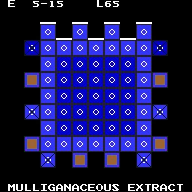

# CandyCrush
This is a GitHub repository of __historical configs__ and __config extractor__ for Candy Crush games. Currently, the repository is supporting Candy Crush Saga and Candy Crush Soda Saga.
I have also developed an extractor (which is semi-closed source) to analyze each of the thousands-strong levels and config sets of Candy Crush. This is _not_ an open-source project.

The past year I have been mostly away on other private projects, research, and full-time employment. Personal circumstances for me have also been highly unfavorable. It took only until now where I am able to consistently return to full-time activity.



# File Structure

The file structure as of now are:

```
archive     : This directory lists select archived config files. They are categorized by epoch. Please do not try to decipher the names.
blueprints  : This directory lists the most current blueprints for each level for the game. This directory has been cleared for now.
charts      : This directory lists all current and historical statistical charts for the games.
    Systematic1: These charts were made during the first systematic era (2020-2023).
*_Extractors: These directories include all extractor versions and the instant extractors and scripts.
*_Scripts   : These directories include all instant scripts for transferring app config files to this directory, and then processing the contents for data analysis and presentation to the wiki and discord. Subdirectories are for certain functionalities regarding specific config files and sections of the wiki.
    *_extract: All instant extractors and config file converters.
    hexagon  : All scripts for determining hexagon levels and converting them into a Lua script for the wiki.
    wikia:   : All scripts for presenting information and charts on Fandom and Discord activity.
```

# Timeline
Unfortunately I have been away for years, and only recently came back. An extenuating circumstance happening during the covid years had significantly limited my involvement with Candy Crush Saga. 2020 and 2021 have been especially terrible, as I have to deal with an extenuating family situation. I had to pause my development of this now-legacy extractor program until the 2026 Winter Olympics.

## Halloween 2023 Revival Attempt
As discussed on Discord, I noticed several significant concerns regarding the current state of the wiki, but this is also due to the booster-heavy nature of modern gameplay progression, the dearth of comments especially for the high levels and episodes, the focus on events rather than on the main map, and the de-emphasis of scoring and story. As a result, to keep the wiki up-to-date, there has to be radical changes.

I have been mostly inactive during this period although I have played this game in two spates, mostly in the holiday season.

## Valentine 2026 Revival
Originally strictly a closed-source solo project, I am gathering collaborators so they can use my extractor software. The software will be rearchitectured to a microservices-based solution. An instant extractor implemented in Python has been established.

# TODO
Currently, only _Candy Crush Saga_ is in active development. I have worked on the _Candy Crush Soda Saga_ but I have unfortunately decided to put this project on a long hiatus. Our ultimate goal is to have an extractor for _all_ King Saga games, including that of games that have faced their [Farewell](https://www.youtube.com/watch?v=KeteVVXPkAU).